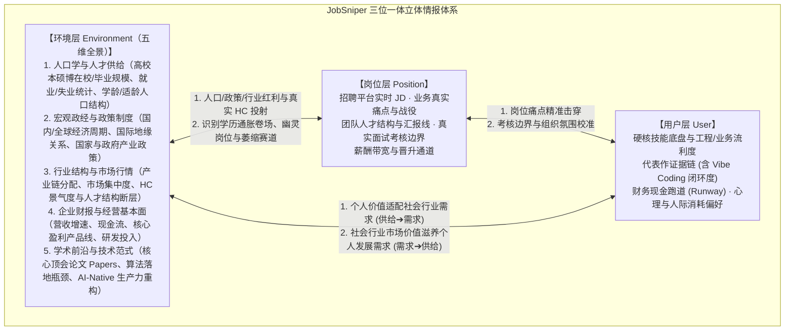

# JobSniper「环境 - 岗位 - 用户」三位一体立体情报体系架构规范

> **状态**：V2.0 核心架构设计规范  
> **关联文档**：[`docs/PRD.md`](PRD.md) · [`docs/CODING_GUIDELINES.md`](CODING_GUIDELINES.md) · [`.agents/skills/career-counseling/SKILL.md`](../.agents/skills/career-counseling/SKILL.md)

---

## 1. 背景与问题定义：为什么“二元平面匹配”不够用？

在 JobSniper 早期版本（V1.x）及市面上绝大多数 AI 求职工具中，系统仅构建在 **「用户（User）↔ 岗位（Position）」** 的二元平面结构之上：
- **用户侧**：简历文本、技能置信度 JSON（`current_user.json`）、项目自述（`master_profile.md`）。
- **岗位侧**：从智联招聘、BOSS 直聘爬取的岗位 JD 详情与基础公司标签（`storage_layer/positions/`）。

### 1.1 真实会话暴露的系统性缺陷
在真实的职业规划与求职决策场景中（例如：具备 3 年信奥高阶教研交付经验 + 独立 Vibe Coding 上线自适应学习小程序的复合背景求职者，面临“AI-Native 产品工程师”、“智能教研负责人”、“技术型 AI 教育产品经理”与“纯教育算法岗”的路径抉择），仅靠用户简历和岗位 JD 库会产生三大致命盲区：

1. **假性匹配陷阱（Ghost Matching & Dying Tracks）**：
   - 仅做 JD 关键词匹配（ATS Matching），无法感知目标企业刚发布的财报是否亏损裁员、所在业务线是否处于战略收缩期、岗位是否为 HR 刷 KPI 的“幽灵岗位（Ghost Job）”。
2. **考核错位与冒名顶替陷阱（Assessment Mismatch）**：
   - JD 往往是 HR 拼凑的“理想化愿望清单”。二元模型会机械引导求职者去修补底层算子推导或名校硕博专属的理论壁垒（如松鼠 AI 纯算法岗的顶会论文门槛），导致求职者在错误的战场上陷入严重的“冒名顶替感”，却忽视了自己在应用层闭环上的碾压级优势。
3. **结构性生态位盲区（Blindness to Talent Gaps）**：
   - 脱离对行业财报增长极（如好未来转向学习机伴学与素养中心、网易有道转向 AI 订阅与端侧硬件）的洞察，系统看不见行业中**“传统教培老师不懂 AI 工程边界，纯互联网 PM 不懂学生认知负荷与一线教学心智”**的巨大人才断层，无法为求职者定位出高溢价、高胜率的“复合生态位”。

---

## 2. 核心理论模型：三位一体与双向适配

为彻底解决上述缺陷，JobSniper 将底层情报与决策架构升级为 **「环境（Environment）- 岗位（Position）- 用户（User）」三位一体立体情报体系**。



### 2.1 三维情报要素与环境层五维拆解

| 维度 | 子维度 / 核心问题 | 关键情报颗粒度 | 本地存储映射 |
| :--- | :--- | :--- | :--- |
| **环境层 (Environment)**<br>*(宏观慢变量 + 中观快变量)* | **E1. 人口学与人才供给统计**<br>*(谁在同台竞争？下游用户群在扩大还是萎缩？)* | 1. **高校人才供给队列**：本科、硕士、博士历年在校人数、同年应届毕业人数与学科结构历史变化（测算“学历通胀率”与赛道拥挤度）<br>2. **就业与失业统计**：就业人口、城镇调查失业率、青年失业率、人才跨城/跨行业流动<br>3. **下游人口结构**：出生率、老龄化率、各学段（小/初/高/高教）适龄人口波峰波谷推移 | `storage_layer/markets/demographics/` |
| ↳ | **E2. 宏观政经与国家/政府政策**<br>*(制度红利在哪？全球与国内大势如何？)* | 1. **国内外经济周期**：国内 GDP/消费分级、全球经济走势、创投融资（VC/PE）环境与利率/汇率周期<br>2. **国际政治经济关系**：算力/供应链博弈、跨国贸易壁垒、中企出海（东南亚/欧美/中东/拉美）合规与地缘风险<br>3. **国家与政府政策**：国家五年规划、“人工智能+”行动、教育/科技监管白名单、拔尖创新人才选拔政策、地方人才补贴 | `storage_layer/markets/macro_policy/` |
| ↳ | **E3. 行业结构与市场行情**<br>*(行业钱怎么分？哪里存在结构性缺口？)* | 1. **行业结构与发展**：产业链上下游利润分配、市场集中度（垄断 vs 分散）、商业模式演进<br>2. **市场行情与人才断层**：真实 HC 供求景气度、供过于求的内卷红海 vs 极度饥渴的跨界复合型缺口 | `storage_layer/markets/industries/` |
| ↳ | **E4. 企业财报与经营基本面**<br>*(目标公司真有钱招人吗？核心战役是什么？)* | 上市公司季报/年报营收增速、归母净利润、经营性现金流、核心造血产品线、战略收缩与扩张部门 | `storage_layer/markets/companies/` |
| ↳ | **E5. 学术论文与技术范式前沿**<br>*(技术真正卡在哪里？如何建立认知代差？)* | 顶会论文（Papers，如 NeurIPS/KDD/ACL/教育技术期刊）核心算法突破与局限、学术理论向工程产品转化的瓶颈、AI-Native 生产力范式转移 | `storage_layer/markets/papers_and_trends/` |
| **岗位层 (Position)** | **微观组织与真实考核**<br>*(这个团队为什么招人？真正考什么？)* | 1. **表面要求 vs 隐性门槛**：第一学历卡点、硕博硬门槛、必需年限<br>2. **核心业务矛盾**：新业务 0 到 1 试水、成熟业务提效、还是填补离职坑位<br>3. **考核方式**：考手撕底层算子、考产品原型闭环、还是考教研交付能力 | `storage_layer/positions/` |
| **用户层 (User)** | **个体能力资产与需求边界**<br>*(我的独特长板是什么？我的底线在哪里？)* | 1. **能力资产与复合长板**：跨界壁垒（如“教学心智 + AI 全栈流利度”）<br>2. **项目证据层级**：本人架构决策、AI 辅助生成、真实运行、用户与商业验证<br>3. **个体需求与约束**：现金流止损线、日常沟通/独处精力比、偏好的组织形态 | `storage_layer/personas/` |

### 2.2 五大权威情报媒介矩阵（Multi-Source Media Matrix）

为确保环境层情报真实可靠，杜绝自媒体二手焦虑与主观臆测，系统确立五大标准情报媒介源：

| 媒介类别 | 承载情报维度 | 典型权威信源示例 | 变量性质与决策作用 |
| :--- | :--- | :--- | :--- |
| **1. 统计公报与人口普查** | 人口学、高校本硕博在校/毕业人数、就业/失业统计 | 国家统计局《统计年鉴》、教育部《全国教育事业发展统计公报》、人社部统计公报、各省市高校毕业生就业质量报告 | **极硬慢变量（3–10 年周期）**：提前看穿“硕博扩招导致的纯算法/基础研发学历贬值”与“适龄学段人口达峰规律”。 |
| **2. 政府政策与法规公文** | 国家战略、行业监管红线、国际贸易与出海政策 | 国务院政策文件库、教育部/工信部/发改委专项通知、地方产业扶持白皮书、海外合规法案 | **制度变量（决定赛道生死）**：识别政策顺风车（如科学/信奥素养、AI 助学）与监管雷区。 |
| **3. 企业财报与业绩电话会** | 企业营收结构、利润率、现金流、当季战略主航道 | 美股 SEC (10-K/20-F/6-K)、港交所披露易、A 股巨潮资讯网、财报电话会（Earnings Call）纪要 | **商业硬指标（1–4 季度周期）**：验明企业真金白银投向哪里，区分“真扩招造血部门”与“亏损裁员部门”。 |
| **4. 学术论文与技术报告** | 算法底层逻辑、评测基准（Benchmark）、工程落地瓶颈 | arXiv、Google Scholar、CCF-A/教育数据挖掘（EDM）顶会论文、头部 AI Lab Technical Report | **认知先导变量（构建降维壁垒）**：从论文中提炼真实技术难点（如 FSRS 参数漂移与反应时噪声耦合），赋能硬核简历与面试深挖。 |
| **5. 深度新闻与行业研报** | 市场行情、产业链结构、投融资动态、组织架构调整 | 头部券商深度行业研报、权威财经/科技媒体深度报道、一级市场创投数据库 | **高频快变量（月/周级校准）**：敏捷捕捉市场冷暖、团队动荡与新兴独角兽机会。 |

### 2.3 双向价值适配机制（Two-Way Adaptation）

JobSniper 拒绝单向的“求职者迎合招聘方”，确立双向适配准则：

1. **正向适配：用户个人价值 ➔ 社会环境与行业市场需求（供给适配需求）**
   - **目标**：实现个人能力资产的高溢价变现与不可替代性。
   - **方法**：结合**人口学供给统计**（避开本硕博扩招洪峰正面扎堆的同质化岗位）与**行业/财报痛点**（锁定企业有钱但招不到人的结构性复合断层），将用户的过往经历与项目重构为“能够直接解决该瓶颈的现成方案”。
2. **反向适配：社会环境与行业市场价值 ➔ 用户个人需求（环境滋养个体）**
   - **目标**：保障求职者的心理健康、财务安全与长期职业复利。
   - **方法**：结合**宏观政经周期与行业生命周期**，过滤掉处于人口/政策逆风期、资金链脆弱或组织内耗严重的选项，选择与用户工作状态偏好（如沉浸式 AI 结对构建 vs 跨部门产品统筹）及现金跑道相匹配的组织生态。

---

## 3. 存储层架构设计：`storage_layer/markets/`

在原有的 `personas/` 和 `positions/` 基础上，`storage_layer/` 正式引入第三大子目录 `markets/`，下设五大标准维度子目录。

### 3.1 目录树结构

```text
storage_layer/
├── personas/                           # 【用户层】个体画像与事实库
│   ├── current_user.json
│   ├── master_profile.md
│   └── career_profile.md
├── positions/                          # 【岗位层】招聘平台微观岗位库
│   ├── boss_intelligence_vault/
│   └── zhilian_intelligence_vault/
└── markets/                            # 【环境层】社会、人口、政经、行业与企业全景情报库
    ├── _市场情报总索引.md               # 环境层全局导航索引表
    ├── demographics/                   # 1. 人口学与人才供给统计（本硕博在校/毕业、就业/失业、学龄人口）
    │   ├── _人口与人才统计索引表.md
    │   └── 中国高校本硕博规模与学龄人口结构推演.md
    ├── macro_policy/                   # 2. 宏观经济、国际政经与国家/政府政策
    │   ├── _宏观政经与政策索引表.md
    │   └── 国内外宏观经济与AI教育产业政策演进.md
    ├── industries/                     # 3. 行业结构、市场行情与人才供需雷达
    │   ├── _行业赛道索引表.md
    │   └── AI与教育科技/
    │       ├── 2025-2026_教育大模型商业化与人才断层报告.md
    │       └── ...
    ├── companies/                      # 4. 重点企业财报、战略与组织健康度档案
    │   ├── _重点企业索引表.md
    │   ├── 好未来_财报与AI业务战略档案.md
    │   ├── 网易有道_财报与AI业务战略档案.md
    │   └── ...
    └── papers_and_trends/              # 5. 学术论文前沿（Papers）与技术范式专题
        ├── _论文与趋势专题索引表.md
        ├── FSRS自适应算法与认知负荷论文工程化综述.md
        └── AI-Native产品工程与Vibe-Coding求职生态位.md
```

### 3.2 元数据规范（YAML Frontmatter）

所有存放于 `storage_layer/markets/` 下的情报文档（非 `_` 开头的索引表），必须在文件头部包含以下 YAML Frontmatter：

```yaml
---
intel_type: demographics_stat | macro_policy | industry_radar | company_profile | paper_and_trend
title: [情报文档标题]
dimension: demographics | macro_economy | geopolitics | policy | industry | company_financials | academic_paper
industry: [所属一级行业，如 AI与教育科技，宏观/人口通用报告可填 "跨行业"]
company: [关联公司名称，非企业报告可填 "N/A" 或数组]
media_types: [statistical_bulletin | policy_doc | financial_report | academic_paper | news_research]
fiscal_or_stat_period: [关联统计/财报周期，如 "2020-2026" 或 "2025Q4-2026Q1"]
hc_weather: booming | expanding | steady | shrinking | frozen | N/A
talent_gap_level: critical | high | moderate | saturated | N/A
collected_at: [ISO8601 采集/更新时间，如 2026-11-10T16:00:00+08:00]
valid_until: [建议复核期限，如 2027-02-10]
evidence_level: verified | mixed | preliminary
sources:
  - [权威媒介来源名称、公报/财报/论文标题及 URL]
---
```

### 3.3 市场情报正文标准结构

每份企业或赛道情报文档必须遵循**证据分层原则**（严格区分 `[核实]`、`[材料]`、`[推断]`、`[待验证]`），包含以下核心模块：
1. **核心经营与财务基本面 `[核实]`**：营收增速、盈利状态、现金流健康度、核心造血业务。
2. **当季核心战略与业务痛点 `[核实/推断]`**：正在发力的主航道（如学习机端侧 AI、出海订阅工具）、急需解决的工程或教研瓶颈。
3. **人才结构与招聘真相 `[核实/推断]`**：
   - **扩招主力岗 vs 缩编/冻结岗**；
   - **隐性硬门槛**（如特定岗位是否卡名校硕博/顶会）；
   - **结构性人才断层**（企业最招不到什么样的复合型人才）。
4. **对求职者的双向适配建议 `[推断]`**：
   - 切入该企业/赛道的最佳岗位入口；
   - 简历与面试必须击中的“业务靶心”；
   - 潜在风险提示（如加班强度、业务变动风险、组织层级摩擦力）。

---

## 4. 情报采集与 MCP 工具链演进

### 4.1 情报摄入双通道
1. **Agent 实时联网调研与沉淀通道（即时可用）**：
   - 当触发职业咨询、新赛道探索或定向大厂投递时，Agent 通过 Web Search 检索目标企业的最新财报、业绩会纪要、行业研报及最新招聘动态；
   - 按照 3.2 与 3.3 规范结构化提炼后，写入 `storage_layer/markets/`，实现“一次调研，长期复利”。
2. **MCP Server 资源与工具扩展（规划演进）**：
   - **新增 MCP Resource**：
     - `jobsniper://vault/markets/{subpath}`：读取指定行业雷达或公司经营档案。
   - **新增 MCP Tools**：
     - `find_market_intelligence(query, intel_type, industry)`：按关键词、行业或公司检索本地已沉淀的环境与市场情报。
     - `upsert_market_intelligence(category, filename, frontmatter, content)`：将经过核验的财报分析、行业报告标准化归档至 `storage_layer/markets/` 并自动更新对应 `_索引表.md`。

---

## 5. Agent 技能链（Skills Workflow）三维升级规范

为确保「环境 - 岗位 - 用户」三位一体体系在每一次交互中真正生效，JobSniper 旗下的五大核心技能遵循以下协同强制规范：

### 5.1 `career-counseling`（职业决策与咨询）
- **禁止无环境证据的单选题**：面对方向选择或转型纠结时，严禁仅凭用户自述直接抛给用户几个抽象选项。
- **强制执行「三维交叉推演」**：
  1. 先查 `personas`（明确用户能力底盘与偏好边界）；
  2. 再查 `positions`（对比不同路径下的真实 JD 要求）；
  3. **必查 `markets`（若本地缺失或过期，立即联网检索最新财报、行业动态与人才断层数据）**；
  4. 输出横向对比证据表（含典型目标企业、真实 HC 规模、核心考核方式、用户优势性质、薪资区间与主要风险），最后再向用户确认主观偏好问题。

### 5.2 `job-recommend`（三维岗位推荐）
- **升级打分模型**：将原有的二维打分（岗位契合 + 技能匹配）升级为**三维加权评分模型**：
  - **个体-岗位匹配度（55%）**：岗位方向契合（25%）+ 技能与复合长板匹配（20%）+ 薪资地点符合度（10%）；
  - **环境-组织健康度（25%）**：企业财报/现金流健康度与赛道景气度（15%）+ HC 真实性与扩张态势（10%）；
  - **生态位胜率与门槛友好度（20%）**：是否避开无效内卷红海（10%）+ 复合背景是否命中行业人才断层（10%）。

### 5.3 `resume-tailor` & `resume-matcher`（痛点穿透型简历定制与诊断）
- **超越纯字面 ATS 对齐**：
  - 在解构目标岗位 JD（第 2 步）时，同步加载目标企业/行业的 `markets` 档案。
  - **STAR 子弹条重构升级**：不仅植入 JD 技术名词，更要让 **S（背景/痛点）** 与 **R（成果价值）** 直接对齐该企业当季的战略战役（例如：投递好未来/有道时，重点突出“启发式引导学习、认知负荷控制、端侧低延迟工程闭环”，而非泛泛而谈“开发了一个背单词小程序”）。

### 5.4 `career-interview`（深度经历访谈与模拟面试）
- **校准真实考核边界**：
  - 针对 AI 辅助编程（Vibe Coding）或跨界项目，结合目标赛道的真实面试考核方式（例如：AI PM 与应用工程师考的是“场景痛点定义、系统架构选型、边界兜底、端到端闭环与真实用户验证”，而非手推底层数学公式），引导用户挖掘最具说服力的工程与业务决策证据，彻底消除冒名顶替感。
